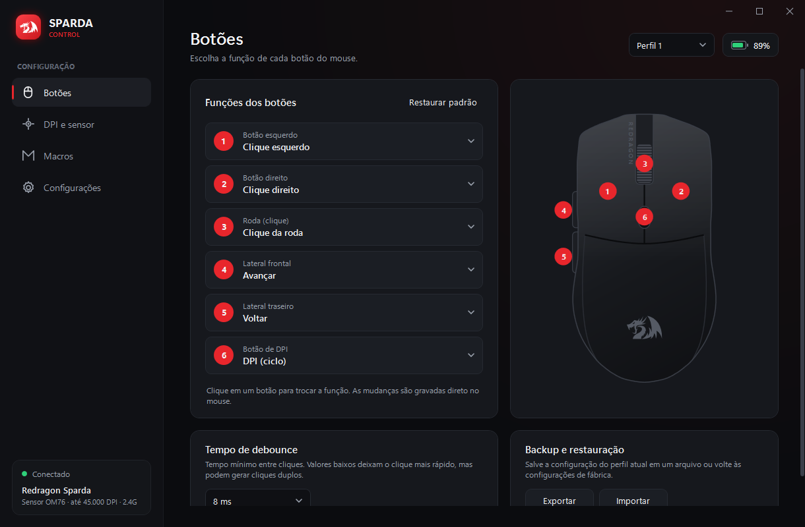
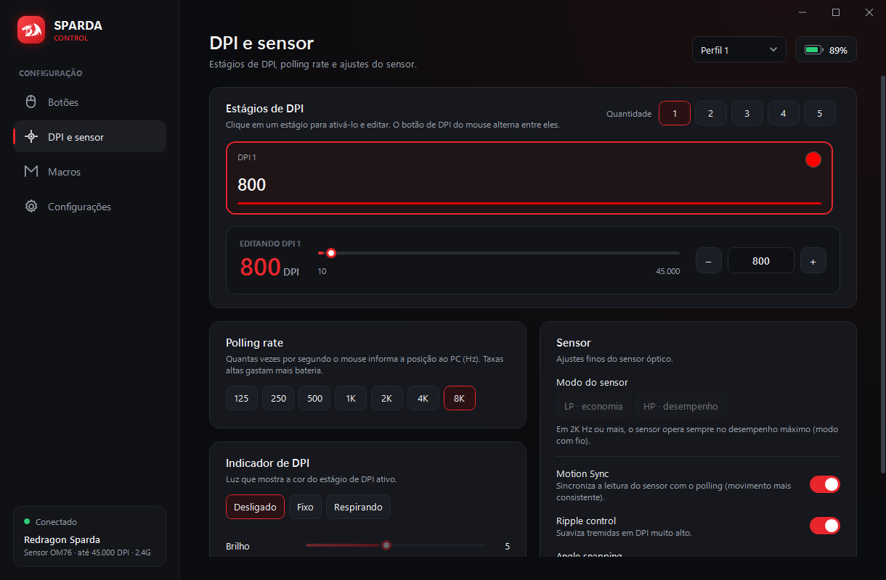
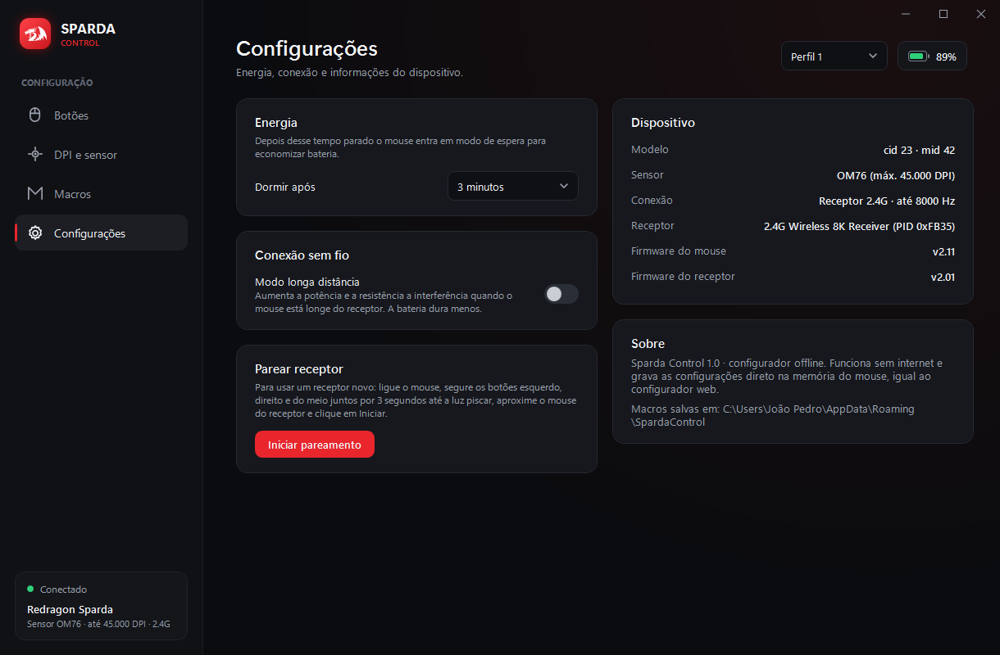
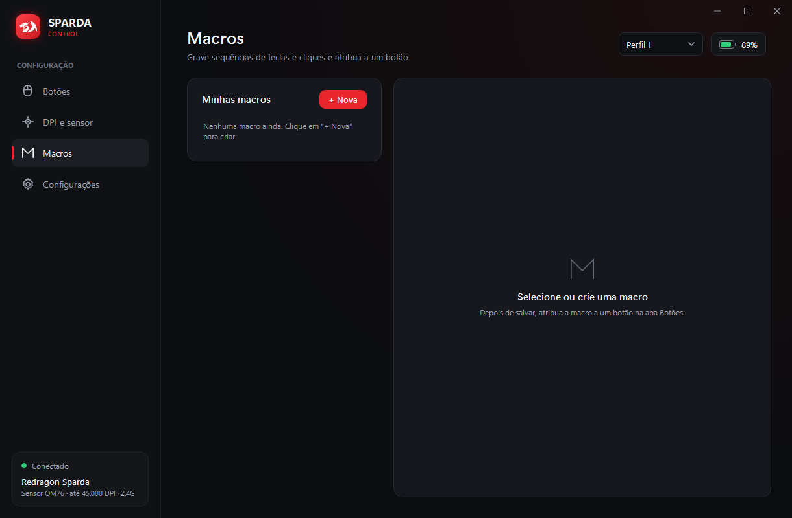

<div align="center">

# Sparda Control

**Configurador offline para o mouse Redragon Sparda**

Configure botões, DPI, sensor, macros e muito mais direto no Windows, sem internet e sem navegador.




</div>

---

> [!IMPORTANT]
> **Este não é um software oficial da Redragon.** O Sparda Control foi criado de forma independente por um usuário da marca, para facilitar e melhorar a experiência de uso do mouse. "Redragon" e o logotipo da Redragon pertencem aos seus respectivos donos e aparecem aqui apenas para identificar o dispositivo compatível.

## Por que existe

O Redragon Sparda não tem um driver instalável. A configuração oficial é feita pelo site [controlhub.top/redragonzone](https://controlhub.top/redragonzone/), que só funciona com internet e em navegadores com suporte a WebHID.

O Sparda Control faz o mesmo trabalho como um programa nativo do Windows:

- **Funciona offline.** Abriu, configurou.
- **É rápido.** Detecta o receptor sozinho, sem precisar escolher o dispositivo em pop-up.
- **Grava direto no mouse.** As configurações ficam salvas na memória do mouse, então o programa não precisa ficar aberto depois.

## Recursos

| Área | O que dá para fazer |
|---|---|
| **Botões** | Trocar a função de cada um dos 6 botões: cliques, DPI (ciclo, + e -), rolagem horizontal, multimídia, combo de teclas, macro, disparo rápido, troca de polling rate ou desativar |
| **DPI** | De 1 a 5 estágios com valor e cor individuais, de 10 até 45.000 DPI (conforme o sensor) |
| **Sensor** | Polling rate de 125 a 8000 Hz, modo LP/HP, Motion Sync, Ripple Control, Angle Snapping, desempenho máximo e LOD (quando o sensor suporta) |
| **Macros** | Gravação de teclas com o tempo real entre elas, inserção de cliques do mouse, edição de atrasos e 4 modos de repetição |
| **Iluminação** | Indicador de DPI (fixo ou respirando) e efeitos de luz nos modelos que têm RGB |
| **Perfis** | Troca entre os 4 perfis do mouse |
| **Energia e conexão** | Tempo de sono, modo longa distância e pareamento de receptor |
| **Backup** | Exportar e importar a configuração em arquivo, e restaurar o padrão de fábrica |
| **Status** | Bateria, firmware do mouse e do receptor, e atualização automática quando você muda algo pelo próprio mouse (ex.: botão de DPI) |

## Capturas de tela

<table>
  <tr>
    <td></td>
    <td></td>
  </tr>
  <tr>
    <td align="center">DPI e sensor</td>
    <td align="center">Configurações</td>
  </tr>
  <tr>
    <td></td>
    <td></td>
  </tr>
  <tr>
    <td align="center">Macros</td>
    <td align="center">Botões</td>
  </tr>
</table>

## Instalação

1. Baixe o instalador `SpardaControl-Setup-x.y.z.exe` na página de [Releases](../../releases).
2. Execute e siga as etapas. Não precisa de permissão de administrador nem instalar o .NET, porque ele já vem incluído.
3. Conecte o receptor 2.4G (ou o cabo USB) e abra o **Sparda Control**.

**Requisitos:** Windows 10 (1809) ou superior, 64 bits.

## Compatibilidade

Feito e testado com o **Redragon Sparda** (receptor *2.4G Wireless 8K Receiver*, sensor OM76).

O programa identifica o modelo pelo próprio mouse e usa a mesma base de modelos do configurador web, então outros mouses Redragon atendidos pelo `controlhub.top/redragonzone` (VID `0x3554`) tendem a funcionar. Só o Sparda foi testado de fato.

## Dicas

- **"Em repouso · mexa o mouse":** alguns segundos depois que você para de mexer, o mouse desliga o rádio para economizar bateria. É normal. As configurações continuam visíveis, e basta mexer o mouse para aplicar alterações.
- **Macros:** o mouse só guarda as macros que estão atribuídas a um botão, então a sua lista de macros fica salva no PC, em `%AppData%\SpardaControl`.
- **Debounce baixo:** valores muito baixos podem gerar cliques duplos. Se acontecer, aumente o valor.

## Compilando a partir do código

**Requisitos:** [.NET SDK 11](https://dotnet.microsoft.com/) e, para gerar o instalador, [Inno Setup 7](https://jrsoftware.org/isinfo.php).

```powershell
git clone https://github.com/<seu-usuario>/redragon-sparda.git
cd redragon-sparda

dotnet run --project src/SpardaControl

powershell -ExecutionPolicy Bypass -File build.ps1
```

O `build.ps1` gera o ícone, publica a versão Release autocontida (win-x64) e compila o instalador em `dist\`.

### Estrutura

```
src/
  SpardaControl.Core/   Protocolo HID, mapa da memória do mouse, DPI, botões e macros
  SpardaControl/        Aplicativo WPF (interface)
tools/
  SpardaProbe/          Ferramenta de diagnóstico pelo terminal
installer/              Script do Inno Setup, termo de uso e gerador de imagens
docs/screenshots/       Imagens deste README
```

### Diagnóstico

```powershell
dotnet run --project tools/SpardaProbe
dotnet run --project tools/SpardaProbe -- --write-test
```

O primeiro comando só lê: lista as interfaces HID do receptor e mostra a configuração atual decodificada. O segundo regrava os mesmos valores que já estão no mouse e confirma que a memória continuou igual.

## Como funciona (protocolo)

<details>
<summary>Detalhes técnicos</summary>

- O receptor (VID `0x3554`, PID `0xFB35` no Sparda) expõe uma interface HID *vendor-defined* com relatórios de entrada e saída de ID `8`, cada um com 16 bytes.
- **Pacote:** `[comando, status, endereço_alto, endereço_baixo, tamanho, dados×10, checksum]`. A soma do ID do relatório com os 16 bytes deve dar `0x55` (módulo 256).
- **Principais comandos:** `1` identificação (cid/mid), `3` mouse online, `4` bateria, `7` gravar memória, `8` ler memória, `9` restaurar fábrica, `14`/`15` ler/trocar perfil, `18`/`29` versão de firmware do mouse/receptor.
- **Memória de configuração:** 256 bytes por perfil. Ajustes de 1 byte são gravados como `[valor, 0x55 - valor]`.

| Endereço | Conteúdo |
|---|---|
| `0` | Polling rate |
| `2` / `4` | Quantidade de estágios / estágio atual |
| `12` | Valores de DPI (8 × 4 bytes) |
| `44` | Cores de DPI (8 × 4 bytes) |
| `76`–`82` | Indicador de DPI |
| `96` | Função dos botões (4 bytes cada) |
| `160` | Iluminação |
| `169`–`185` | Debounce, Motion Sync, sono, Angle Snap, Ripple, desempenho, modo do sensor |
| `256 + 32·n` | Combo de teclas / multimídia do botão *n* |
| `768 + 384·n` | Macro do botão *n* |

- Quando algo muda no próprio mouse (botão de DPI, troca de perfil), ele envia uma notificação (comando `10`) e o programa relê a configuração.

</details>

## Privacidade

O Sparda Control não acessa a internet. Nenhum dado é coletado ou enviado.

## Aviso legal

Software fornecido "como está", sem garantias. Use por sua conta e risco. A qualquer momento é possível voltar às configurações originais pelo botão **Restaurar fábrica**.
